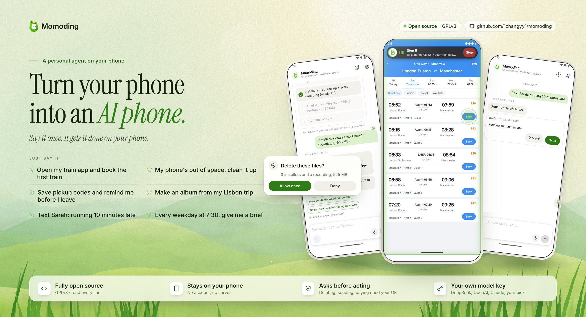
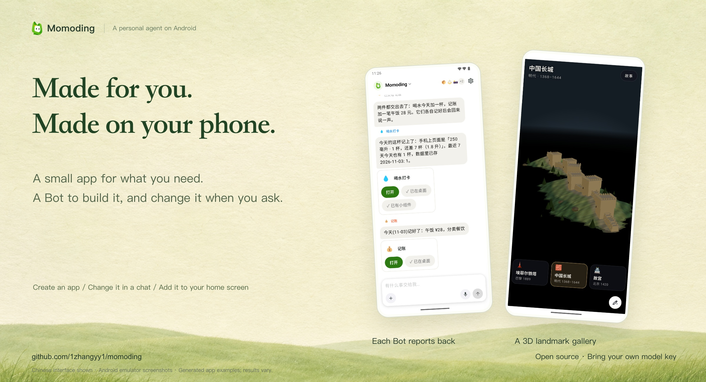
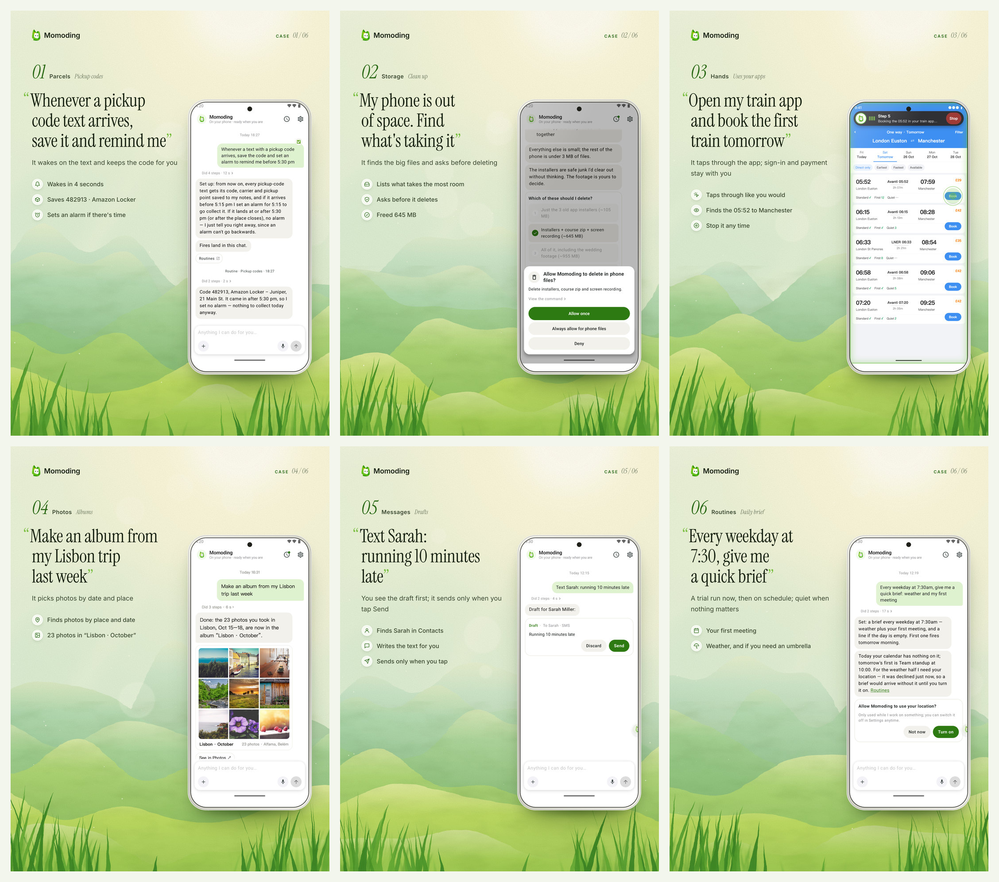

<p align="center">
  
</p>

<h1 align="center">Momoding</h1>

<p align="center"><strong>Describe a small app. Make it your own.</strong><br/>
A personal agent on your Android phone that handles tasks and builds little apps for you.<br/>
Add a home-screen shortcut, use it, and ask its own Bot for changes as you go.</p>

<p align="center">
  <a href="https://github.com/1zhangyy1/momoding/releases/latest"><strong>Download the APK</strong></a>
  · <a href="#get-started">Get started</a>
  · <a href="README.md">简体中文</a>
</p>

<p align="center">
  <a href="https://github.com/1zhangyy1/momoding/releases"></a>
  <a href="LICENSE"></a>
  
  <a href="https://github.com/1zhangyy1/momoding/stargazers"></a>
</p>

<p align="center">
  
</p>

<p align="center"><sub>Screenshots from an Android emulator with the English interface (DeepSeek V4.1 Flash); the train app and photo album screens are illustrations.</sub></p>

> **Current version: 1.0.9, still moving fast.** You can create small apps in a chat and let several Bots work on them. Most polishing so far happened on an emulator and a few real phones; background reliability on heavily customised Android builds is still being tested. Please [open an issue](https://github.com/1zhangyy1/momoding/issues/new/choose) when something goes wrong.

---

## Recent update 1.0.9

- Fixed scrolling in app chats and missing handoffs when several Bots receive work in one step.
- Fixed false “send” approval prompts while editing app code. Actual sends, uploads and deletions still require checks.
- Added an idle timeout for model streams without useful output and prompt cancellation of blocked network reads.

[Full release notes](docs/releases/1.0.9.md) · [Download 1.0.9](https://github.com/1zhangyy1/momoding/releases/tag/v1.0.9)

### 1.0.8: Small apps and multiple Bots

- **Create a small app in a chat.** Each app has its own Bot, which brings back a card to open it. Ask for changes in the main chat or tap the pencil inside the app.
- **Hand off several jobs.** Bots work and report back separately. Tap the name at the top to switch between or manage Bots; each Bot can also have its own app.
- **Open from your home screen.** Add a shortcut with your confirmation. Widgets depend on the phone and launcher.
- **Use phone capabilities.** Apps can pick photos, use the camera or location, and read texts or notifications with permission. Access can be revoked in Settings.
- **Check apps without taking over your screen.** Bots open and check their apps on a background stage. File choices and permission requests wait for you to take over.
- **Fixes and compatibility.** Fixed some missing completion reports; approval notifications follow the app language. ColorOS widgets are unsupported. Some phones pause background work, which resumes when you return.

[Full release notes](docs/releases/1.0.8.md) · [Download 1.0.8](https://github.com/1zhangyy1/momoding/releases/tag/v1.0.8)

## From an idea to an app on your home screen

**Describe it → a Bot builds it → open it from your home screen → ask for changes.**

Try an idea like “make a 3D landmark gallery I can rotate,” “build a poster tool using my photos,” or an expense tracker that fits your habits. Momoding hands the request to a dedicated Bot, which reports back in the original conversation with a card to open the app.

Small apps run inside Momoding and can have a home-screen shortcut. Tap the icon next time to keep using it. They are not standalone APKs.

**Small apps and multiple Bots · 32 seconds, with audio · Chinese interface**

https://github.com/user-attachments/assets/23a38fc7-352b-4260-b561-b34490856553

<p align="center"></p>

## Each app has its own Bot

The app is the interface you use. Its Bot takes care of building and changing it. App data, the Bot's conversation and its project memory are kept so you can pick up where you left off.

- **Ask for changes inside the app.** Tap the pencil and say “make it nighttime, with warmer lights” or “make the title bigger and leave more space.” You can also ask in the main chat.
- **Hand off several jobs.** The main Momoding sends work to the relevant Bots. Each works on its own and reports back. You can go straight to a particular Bot's chat too.
- **Use phone capabilities.** With permission, apps can use photos, the camera and location, and receive texts or notifications when relevant to their purpose.
- **Keep your screen free while it checks.** A Bot checks its app on a background stage. File choices and permission requests wait for you to take over.

<p align="center"><sub>Android emulator screenshots; the interface shown is Chinese. These are model-generated examples, and results vary by model and task. Widgets are available on supported phones; Momoding widgets are currently unavailable on OPPO / OnePlus ColorOS.</sub></p>

## Everyday tasks start in the same chat

Ask Momoding to create a calendar event, set a reminder, look something up, remember a preference or set up a routine.

We want a useful personal agent on the phone you already have. Hand it a one-off task; turn a recurring need into an app of your own. Start with something useful, try it, and keep changing it to fit you.

## Why it feels good to use

What we care about most is not the number of features. It is how light it feels to hand something off:

- **Start in one main chat.** Hand the job to Momoding. When you need a particular Bot, tap the name at the top to switch, or talk to it inside its app.
- **Results first.** When it's done, you get the result in a sentence plus a button to check it ("See in Calendar"). The steps fold into "Did N steps" for when you want them.
- **At most one question.** If something is missing, it asks only the one thing that matters and offers choices. No guessing, no interrogation.
- **It asks before acting.** Deleting, sending and paying show an approval card. Tap "Always allow" once and it just does it next time, leaving one line in the chat.
- **Quiet.** Routines don't notify you unless something matters.
- **Smooth.** It reacts 👀 the moment you send and ✅ when it's done. Replies pop in bubble by bubble, cards rise when they need you and fold to a line once settled.
- **Pick one provider and go.** First run asks for one provider and one key; chat and vision models are set up for you.

## Who we learned from

**OpenMinis is the code foundation**, providing the on-device agent, Linux environment and phone capabilities. We build on that to turn personal needs into small apps with Bots that keep looking after them.

- **[Fibona](https://github.com/FibonaAI/fibona-agent)** inspired making tools on the phone, changing them in place and keeping them for later use.
- **Grok Bot** informed having several Bots, each responsible for something with its own conversation and memory. In Momoding, each Bot can also have its own small app.
- **Instinct and Grok Bot** informed the result, handoff and approval cards in the conversation.
- **[DeepSeek Harness (DSH)](https://github.com/deepseek-ai/deepseek-harness)** is a research reference for ongoing improvements to task execution and recovery.

Here, improving an app means a Bot changing its own small app. The Momoding host updates by checking for and downloading published releases.

## What it can do today

<p align="center"></p>

**Say it once, in the chat:**

- **Reminders, events and alarms**: "Remind me to call the dentist at 3pm tomorrow" creates the reminder and shows a "See in Calendar" button.
- **Preferences**: "From now on, no meetings before 10am, I do school drop-off" adds a small "Remembered" note, and future scheduling follows it.
- **One question when it needs one**: "Set an alarm for me" gets a reply of "What time?" instead of a guess.
- **Drafts you approve**: "Text Sarah: running 10 minutes late" produces an editable draft card. Nothing is sent until you tap Send.
- **Web lookups**: "Will I need an umbrella in London this Saturday?" checks the forecast and answers in a sentence, with next-step buttons when there is something to do.
- **Routines**: "Every weekday at 7:30am, give me a quick brief: weather and my first meeting" does a trial run first, then reports on schedule, and stays quiet when there's nothing that matters.
- **Operating other apps on your screen** (experimental): with the Accessibility permission on, it can tap, scroll and type for you. A capsule on screen shows that it's working, and you can stop it at any time.

**You stay in charge:**

- **It asks first.** Deleting, sending to other people and paying all show an approval card. "Always allow" turns your answer into a rule, which you can remove under Settings → Ask first → Allow rules.
- **See every step.** The "Did N steps" line above each reply opens the exact steps it took.
- **Permissions asked in context.** When it needs your calendar, location or Accessibility, a card in the chat explains why. Once you grant the permission, it picks up where it left off.

## Privacy, in plain terms

- **There's no Momoding account and no Momoding server.** Chats, memory, small-app data, rules and routines are stored on your phone.
- **Your model API key is stored encrypted on the phone** and is only used to call the provider you picked.
- **It is not offline, though.** For the model to understand a request, the conversation and whatever Momoding reads while working on it (a calendar entry, a web page) are sent to **the model provider you chose**. Which provider gets that data is up to you.
- **When it looks something up on the web**, the search words go to Exa, a free search service; pages it reads are fetched by the phone directly from the site.
- **No analytics, ads or third-party tracking SDKs.**

## Get started

1. You need **Android 8.0 or newer**. Download the latest `.apk` from [Releases](https://github.com/1zhangyy1/momoding/releases/latest) and allow your browser to install apps.
2. Open Momoding, pick a model provider and paste your API key. The first-run presets are DeepSeek, Kimi, Qwen, Zhipu GLM, Doubao and SiliconFlow. OpenRouter, OpenAI, Claude, Gemini and others also work. Picking a provider sets up both a chat model and a vision model.
3. Type your first request, or tap one of the examples on the empty chat.
4. To let it operate other apps, go to Settings → Phone permissions → **Hands** and follow the prompts to turn on Accessibility and the overlay permission. Everything else works without it.

> **Updating to 1.0.9:** Official versions 1.0.1–1.0.8 can be updated in place, keeping your data. Version 0.1.0-alpha and early test builds signed with a different key cannot be updated in place; back up the data you need before removing an incompatible build.

## Build from source

Momoding includes an on-device Linux sandbox. Its native dependencies (PRoot, FFmpeg, LAME, rclone) and the Alpine rootfs are built from source:

```sh
git clone --recurse-submodules https://github.com/1zhangyy1/momoding.git
cd momoding

# Needs Android NDK r28+, Go 1.25+ and gomobile
./deps/build_proot.sh && ./scripts/prepare_android_sandbox.sh
./deps/build_rclone_android.sh
mkdir -p src/android/app/libs && cp deps/build/rclone/rclone.aar src/android/app/libs/
cd src/android && ./gradlew :app:assembleDebug
```

[BUILDING.md](BUILDING.md) lists the toolchain requirements and the build failures you're most likely to hit.

**Where the code is:** Momoding's own interface and logic live in `src/android/app/src/main/java/app/momoding/`: the chat cards, first run, permissions, routines, prompts and so on. Everything else stays close to upstream so that OpenMinis updates keep merging cleanly.

## Get involved

- **Bugs and ideas:** [GitHub Issues](https://github.com/1zhangyy1/momoding/issues/new/choose). The most useful report says what you asked it to do and what it actually did.
- **Questions and use cases:** [Discussions](https://github.com/1zhangyy1/momoding/discussions)
- **Code:** pull requests are welcome. Please read [CONTRIBUTING.md](CONTRIBUTING.md) first.

If Momoding saves you some re-typing, remembering or checking, a ⭐ helps a lot.

## License

[GNU General Public License v3.0](LICENSE). Momoding is based on OpenMinis, which is licensed under GPLv3, and it links GPL components (PRoot is GPLv2), so the combined work is released under GPLv3.

## Thanks

Momoding is a fork of [OpenMinis](https://github.com/OpenMinis/OpenMinis), and it exists because of the OpenMinis team. They open-sourced a carefully built on-device agent in full: the agent loop, a Linux sandbox that runs on the phone, device integrations, browser automation, skills, memory and support for many model providers. That is the foundation Momoding stands on. What we add is the product on top: a single assistant conversation, a Chinese-first voice, cards inside the chat, routines and a full visual design. If you like Momoding, please give OpenMinis a ⭐ too, and on iPhone use [Minis](https://apps.apple.com/app/id6759188481). Thanks also to [nanoMuse](https://github.com/nano-muse/nanoMuse) (several modules are ported from it), [Mobilerun (droidrun)](https://github.com/droidrun/droidrun) and [RikkaHub](https://github.com/rikkahub/rikkahub) (ideas behind screen operation), Instinct and Grok Bot (product design references), and iSH, PRoot, Alpine Linux, FFmpeg and the other projects listed in [THIRD_PARTY_LICENSES.md](THIRD_PARTY_LICENSES.md). Momoding is not affiliated with any of these projects.
