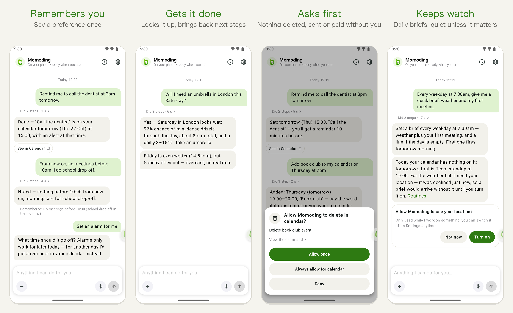
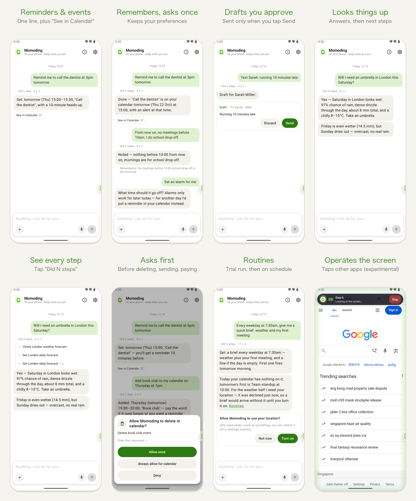

<p align="center">
  
</p>

<h1 align="center">Momoding</h1>

<p align="center"><strong>An assistant that lives on your phone and gets things done.</strong><br/>
Tell it what you saw or thought of. It uses what's on your phone to handle it, remembers how you like things, and keeps an eye on what comes next.</p>

<p align="center">
  <a href="https://github.com/1zhangyy1/momoding/releases/latest"><strong>Download the APK</strong></a>
  · <a href="#get-started">Get started</a>
  · <a href="README.md">简体中文</a>
</p>

<p align="center">
  <a href="https://github.com/1zhangyy1/momoding/releases"></a>
  <a href="LICENSE"></a>
  
  <a href="https://github.com/1zhangyy1/momoding/stargazers"></a>
</p>

<p align="center">
  
</p>

<p align="center"><sub>Real screenshots from an Android emulator with the English interface, running DeepSeek V4.1 Flash.</sub></p>

> **1.0 preview.** Good for everyday trial use, but it is moving fast. Most polishing so far happened on an emulator and a few real phones, and background reliability on heavily customised Android builds is still being tested. Please [open an issue](https://github.com/1zhangyy1/momoding/issues/new/choose) when something goes wrong.

---

## Why

AI chat apps are great at answering questions. The small chores on your phone still fall to you, though: you **re-type** things, **remember** them, and **keep checking** on them.

- The school emails a trip notice, and you copy the date into your calendar by hand, then set a reminder.
- You tell a chatbot to "remember this", and next time it has forgotten.
- You want to know when tickets become available or a price drops, so you check again every few hours.

Momoding takes those three jobs off your hands:

| | What it does for you |
| - | - |
| **Less re-typing** | Hand it a screenshot, a notification or a file, and the event, reminder, alarm or draft gets created. You get a one-line result plus a "See in Calendar" button. |
| **Less remembering** | Say "no meetings before 10am, I do school drop-off" once and it applies that from then on. If it got something wrong, one sentence fixes it. |
| **Less watching** | "Every weekday at 7:30am, give me a quick brief." "Watch this page and tell me when it changes." It only reaches out when something actually changed. |

## How it's different

| | AI chat apps | Built-in phone assistants | Cloud agents | **Momoding** |
| - | :-: | :-: | :-: | :-: |
| Uses what's on your phone (calendar, alarms, contacts, photos, notifications, the screen) | ✗ | ✓ | ✗ | **✓** |
| Remembers you, and you can see and edit what it remembers | weak | weak | ✓ | **✓** |
| Takes on a task and follows up | ✗ | ✗ | ✓ | **✓** |
| Where your data lives | vendor cloud | vendor cloud | vendor cloud | **your phone** |
| Open source, bring your own model key | ✗ | ✗ | ✗ | **✓** |

## What it can do today

<p align="center"></p>

**Say it once, in the chat:**

- **Reminders, events and alarms**: "Remind me to call the dentist at 3pm tomorrow" creates the reminder and shows a "See in Calendar" button.
- **Preferences**: "From now on, no meetings before 10am, I do school drop-off" adds a small "Remembered" note, and future scheduling follows it.
- **One question when it needs one**: "Set an alarm for me" gets a reply of "What time?" instead of a guess.
- **Drafts you approve**: "Text Sarah: running 10 minutes late" produces an editable draft card. Nothing is sent until you tap Send.
- **Web lookups**: "Will I need an umbrella in London this Saturday?" checks the forecast and answers in a sentence, with next-step buttons when there is something to do.
- **Routines**: "Every weekday at 7:30am, give me a quick brief: weather and my first meeting" does a trial run first, then reports on schedule, and stays quiet when there's nothing that matters.
- **Operating other apps on your screen** (experimental): with the Accessibility permission on, it can tap, scroll and type for you. A capsule on screen shows that it's working, and you can stop it at any time.

**You stay in charge:**

- **It asks first.** Deleting, sending to other people and paying all show an approval card. "Always allow" turns your answer into a rule, which you can remove under Settings → Ask first → Allow rules.
- **See every step.** The "Did N steps" line above each reply opens the exact steps it took.
- **Permissions asked in context.** When it needs your calendar, location or Accessibility, a card in the chat explains why. Once you grant the permission, it picks up where it left off.

## Privacy, in plain terms

- **There's no Momoding account and no Momoding server.** Chats, memory, rules and routines are stored on your phone.
- **Your model API key is stored encrypted on the phone** and is only used to call the provider you picked.
- **It is not offline, though.** For the model to understand a request, the conversation and whatever Momoding reads while working on it (a calendar entry, a web page) are sent to **the model provider you chose**. Which provider gets that data is up to you.
- **No analytics, ads or third-party tracking SDKs.**

## Get started

1. You need **Android 8.0 or newer**. Download the latest `.apk` from [Releases](https://github.com/1zhangyy1/momoding/releases/latest) and allow your browser to install apps.
2. Open Momoding, pick a model provider and paste your API key. The first-run presets are DeepSeek, Kimi, Qwen, Zhipu GLM, Doubao and SiliconFlow. OpenRouter, OpenAI, Claude, Gemini and others also work. Picking a provider sets up both a chat model and a vision model.
3. Type your first request, or tap one of the examples on the empty chat.
4. To let it operate other apps, go to Settings → Phone permissions → **Hands** and follow the prompts to turn on Accessibility and the overlay permission. Everything else works without it.

> If you installed any earlier Momoding build (including 0.1.0-alpha and test builds), uninstall it first. Version 1.0 is a new codebase with a new signing key, so it can't update the old app in place. From 1.0 on the key stays the same, so later versions update in place.

## Build from source

Momoding includes an on-device Linux sandbox. Its native dependencies (PRoot, FFmpeg, LAME, rclone) and the Alpine rootfs are built from source:

```sh
git clone --recurse-submodules https://github.com/1zhangyy1/momoding.git
cd momoding

# Needs Android NDK r28+, Go 1.25+ and gomobile
./deps/build_proot.sh && ./scripts/prepare_android_sandbox.sh
./deps/build_rclone_android.sh
mkdir -p src/android/app/libs && cp deps/build/rclone/rclone.aar src/android/app/libs/
cd src/android && ./gradlew :app:assembleDebug
```

[BUILDING.md](BUILDING.md) lists the toolchain requirements and the build failures you're most likely to hit.

**Where the code is:** Momoding's own interface and logic live in `src/android/app/src/main/java/app/momoding/`: the chat cards, first run, permissions, routines, prompts and so on. Everything else stays close to upstream so that OpenMinis updates keep merging cleanly.

## Built on OpenMinis

Momoding is a fork of **[OpenMinis](https://github.com/OpenMinis/OpenMinis)**, an excellent open-source on-device AI agent. The agent loop, Linux sandbox, device integrations, browser automation, skills and memory all come from OpenMinis.

What Momoding adds is the product on top: a single assistant conversation, a Chinese-first voice, result, draft, approval and permission cards inside the chat, routines, presets for Chinese model providers, and a full visual redesign. Thanks to the OpenMinis team, and to the projects they build on, including [iSH](https://github.com/ish-app/ish), [PRoot](https://github.com/termux/proot), [Alpine Linux](https://alpinelinux.org) and FFmpeg. The full third-party license list is in [THIRD_PARTY_LICENSES.md](THIRD_PARTY_LICENSES.md).

Momoding is not affiliated with the OpenMinis project.

## Get involved

- **Bugs and ideas:** [GitHub Issues](https://github.com/1zhangyy1/momoding/issues/new/choose). The most useful report says what you asked it to do and what it actually did.
- **Questions and use cases:** [Discussions](https://github.com/1zhangyy1/momoding/discussions)
- **Code:** pull requests are welcome. Please read [CONTRIBUTING.md](CONTRIBUTING.md) first.

If Momoding saves you some re-typing, remembering or checking, a ⭐ helps a lot.

## License

[GNU General Public License v3.0](LICENSE). Momoding is based on OpenMinis, which is licensed under GPLv3, and it links GPL components (PRoot is GPLv2), so the combined work is released under GPLv3.
