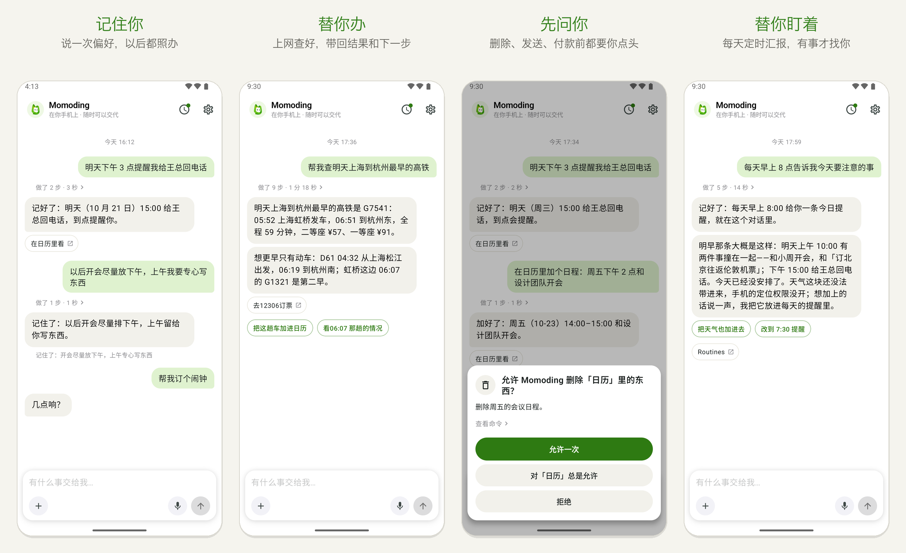
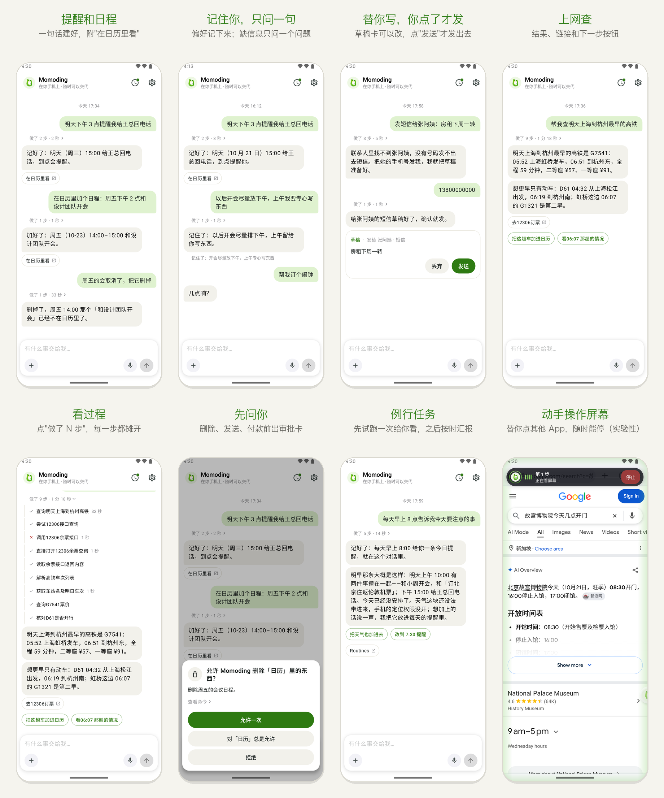

<p align="center">
  
</p>

<h1 align="center">Momoding</h1>

<p align="center"><strong>住在你手机里的办事员。</strong><br/>
看到什么、想到什么，交代一句，它用手机上的东西帮你办好，记住你的习惯，替你盯着后续。</p>

<p align="center">
  <a href="https://github.com/1zhangyy1/momoding/releases/latest"><strong>下载 APK</strong></a>
  · <a href="#三分钟上手">三分钟上手</a>
  · <a href="README.en.md">English</a>
</p>

<p align="center">
  <a href="https://github.com/1zhangyy1/momoding/releases"></a>
  <a href="LICENSE"></a>
  
  <a href="https://github.com/1zhangyy1/momoding/stargazers"></a>
</p>

<p align="center">
  
</p>

<p align="center"><sub>以上都是模拟器上的真实运行截图，模型为 DeepSeek V4.1 Flash。</sub></p>

> **1.0 预览版。** 可以日常试用，但还在快速迭代；目前主要在模拟器和少数真机上打磨，国产系统的后台保活还在测。遇到问题请[提 Issue](https://github.com/1zhangyy1/momoding/issues/new/choose)。

---

## 为什么做它

AI 聊天已经很会回答问题，但手机上的事还是要靠自己**记、搬、盯**：

- 群里一张会议通知截图，要自己切到日历、敲时间地点、再设个提醒；
- 跟 AI 说"帮我记一下"，下次它就忘了；
- 想知道票什么时候有、价格什么时候降，只能隔三差五自己去看。

Momoding 想把这三件事接过来：

| | 它替你做的 |
| - | - |
| **少搬** | 截图、通知、文件交给它，日程、提醒、闹钟、草稿就建好了，回你一句结果和一个"在日历里看"。 |
| **少记** | "会议尽量放下午""提醒提前一小时"，说一次就记住，以后办事自动用上；记错了一句话就能改。 |
| **少盯** | "每天早上 8 点告诉我今天要注意的事""盯着这个页面，变了告诉我"，有变化才找你，没变化就安静。 |

## 它和别的有什么不一样

| | AI 聊天 App | 手机自带助手 | 云端 Agent | **Momoding** |
| - | :-: | :-: | :-: | :-: |
| 能用手机上的东西（日历、闹钟、通讯录、照片、通知、屏幕） | ✗ | ✓ | ✗ | **✓** |
| 记得你，而且你能查看、修改 | 弱 | 弱 | ✓ | **✓** |
| 接手一件事，持续跟进 | ✗ | ✗ | ✓ | **✓** |
| 数据在哪 | 厂商云端 | 厂商云端 | 厂商云端 | **你的手机** |
| 开源、自带模型 Key | ✗ | ✗ | ✗ | **✓** |

## 现在能做什么

<p align="center"></p>

**对话里交代一句就办：**

- **提醒、日程、闹钟**："明天下午 3 点提醒我给王总回电话" → 建好，附"在日历里看"。
- **记住偏好**："以后开会尽量放下午" → 一行小字"记住了"，以后排日程自动照办。
- **缺信息只问一个问题**："帮我订个闹钟" → "几点响？"，不乱猜。
- **替你写、你点了才发**："发短信给张阿姨：房租下周一转" → 草稿卡，可以改，点"发送"才真的发出去。
- **上网查**："帮我查明天上海到杭州最早的高铁" → 结果和下一步按钮（"订这班""加到日历"）。
- **例行任务**："每天早上 8 点告诉我今天要注意的事" → 先试跑一次给你看，之后按时汇报，没要紧事不推通知。
- **在手机屏幕上操作其他 App**（实验性）：打开无障碍权限后，它可以替你点、滑、输入；手机上会出现一个胶囊提示它正在操作，随时能停。

**你始终说了算：**

- **先问你**：删除、对外发送、付款这类事，执行前出一张审批卡；选"始终允许"会变成一条规则，在 设置 → 先问你 → 允许规则 里随时能删。
- **看过程**：每条回复上方的"做了 N 步"点开就是它做了什么。
- **权限就地申请**：需要日历、位置、无障碍时，在对话里出一张卡片说明用途，打开后自动接着做。

## 隐私：说清楚"本地"是什么意思

- **没有 Momoding 账号，没有 Momoding 服务器。** 对话、记忆、规则、例行任务都存在你的手机上。
- **模型 Key 加密存在手机上**，只用来调用你自己选的模型服务。
- **但它不是离线的**：要让模型理解你的请求，对话内容和它办事时读到的内容（比如一条日程、一个网页）会发给**你选的那家模型服务**。选哪家、发给谁，由你决定。
- **没有统计、广告或第三方追踪 SDK。**

## 三分钟上手

1. 手机需要 **Android 8.0 或更高版本**。到 [Releases](https://github.com/1zhangyy1/momoding/releases/latest) 下载最新的 `.apk`，允许浏览器安装应用。
2. 打开 Momoding，选一家模型服务，填入你的 API Key。首次使用预设了：
   **DeepSeek**（好用不贵）、**Kimi**、**通义千问**、**智谱 GLM**、**豆包**、**硅基流动**；也支持 OpenRouter、OpenAI、Claude、Gemini 等。
   选一家就会自动配好对话模型和看图模型。
3. 在对话框里交代第一件事，或者点空白页上的例子试试。
4. 想让它替你操作其他 App：设置 → 手机权限 → **动手操作屏幕**，按提示打开无障碍和悬浮窗。不开也能用其他功能。

> 以前装过任何旧版 Momoding（包括 0.1.0-alpha 和测试版）的话，请先卸载旧版再装 1.0。新版换了底座和签名，不能直接覆盖升级；从 1.0 起签名固定，以后的版本都能直接覆盖升级。

## 常见问题

<details>
<summary><b>要花钱吗？</b></summary>

App 免费、开源。模型调用由你选的服务商按用量收费，费用直接付给服务商，Momoding 不经手。DeepSeek 这类服务日常用下来花费不多。
</details>

<details>
<summary><b>为什么不上应用商店？</b></summary>

它要用无障碍、悬浮窗、后台常驻这些能力替你办事，应用商店对这类 App 审核很严。现阶段先在 GitHub 发布，所有代码都可以审查。
</details>

<details>
<summary><b>它会不会乱操作我的手机？</b></summary>

不开无障碍权限，它就碰不到其他 App。开了以后，删除、发送、付款这类事都会先问你；操作时屏幕上有胶囊提示，随时能停；每一步都能在"看过程"里查到。
</details>

<details>
<summary><b>有 iOS 版吗？</b></summary>

目前只做 Android。仓库里的 `src/ios/` 是上游 OpenMinis 的 iOS 代码，Momoding 没有维护。
</details>

## 从源码构建

Momoding 带一个运行在手机上的 Linux 沙箱，原生依赖（PRoot、FFmpeg、LAME、rclone）和 Alpine rootfs 都要从源码构建：

```sh
git clone --recurse-submodules https://github.com/1zhangyy1/momoding.git
cd momoding

# 需要 Android NDK r28+、Go 1.25+ 和 gomobile
./deps/build_proot.sh && ./scripts/prepare_android_sandbox.sh
./deps/build_rclone_android.sh
mkdir -p src/android/app/libs && cp deps/build/rclone/rclone.aar src/android/app/libs/
cd src/android && ./gradlew :app:assembleDebug
```

工具链要求和常见构建错误见 [BUILDING.md](BUILDING.md)。

**代码在哪：** Momoding 自己的界面和逻辑在 `src/android/app/src/main/java/app/momoding/`（对话里的卡片、首次使用、权限、例行任务、提示词等）；其余基本保持上游原样，方便持续合并 OpenMinis 的更新。

## 站在 OpenMinis 的肩膀上

Momoding 是 **[OpenMinis](https://github.com/OpenMinis/OpenMinis)** 的一个 fork。OpenMinis 是一款很出色的开源手机端 AI Agent，智能体循环、Linux 沙箱、设备能力、浏览器自动化、技能和记忆，都来自它。

Momoding 在此之上做的是**产品形态**：单一的"办事员"对话、中文优先的说话方式、对话里的结果卡/草稿卡/审批卡/权限卡、例行任务、国内模型预设，以及一整套视觉设计。感谢 OpenMinis 团队，也感谢他们依赖的 [iSH](https://github.com/ish-app/ish)、[PRoot](https://github.com/termux/proot)、[Alpine Linux](https://alpinelinux.org)、FFmpeg 等项目。完整的第三方许可清单见 [THIRD_PARTY_LICENSES.md](THIRD_PARTY_LICENSES.md)。

Momoding 和 OpenMinis 官方没有隶属关系。

## 参与进来

- **反馈问题、提需求**：[GitHub Issues](https://github.com/1zhangyy1/momoding/issues/new/choose)。说清楚你想让它办什么、它实际做了什么，比什么都有用。
- **聊想法、分享用法**：[Discussions](https://github.com/1zhangyy1/momoding/discussions)
- **提交代码**：欢迎 PR，先看 [CONTRIBUTING.md](CONTRIBUTING.md)。

如果 Momoding 帮你少搬、少记、少盯了一点，给个 ⭐ 是对我们最大的鼓励。

## 许可证

[GNU General Public License v3.0](LICENSE)。Momoding 基于 GPLv3 的 OpenMinis，并链接了 GPL 组件（PRoot 为 GPLv2），因此整体以 GPLv3 发布。

## 致谢

**Momoding 能做出来，首先要感谢 [OpenMinis](https://github.com/OpenMinis/OpenMinis)。**

我们自己开始做的时候，从零搭了智能体运行时，走了很多弯路。OpenMinis 团队把一个打磨得非常好的手机端 Agent 完整开源了：智能体循环、跑在手机上的 Linux 沙箱、日历通讯录等设备能力、浏览器自动化、技能、记忆、众多模型服务的接入。这些都是 Momoding 今天的地基，没有它们，我们不可能在几周内做出一个能真正办事的产品。他们相信"产品的优势来自和用户之间紧密的反馈"，这也是 Momoding 想坚持的做法。

如果你喜欢 Momoding，也请去给 [OpenMinis](https://github.com/OpenMinis/OpenMinis) 点一个 ⭐。在 iPhone 上，推荐直接用 [Minis](https://apps.apple.com/app/id6759188481)。上游本身的问题，我们会反馈给 OpenMinis。

同样感谢：

- [nanoMuse](https://github.com/nano-muse/nanoMuse)（GPLv3）：主对话、审批与风险规则、草稿等不少模块从它移植而来
- [iSH](https://github.com/ish-app/ish)、[PRoot](https://github.com/termux/proot)、[Alpine Linux](https://alpinelinux.org)、[FFmpeg](https://ffmpeg.org)、[Shizuku](https://github.com/RikkaApps/Shizuku-API) 等 OpenMinis 依赖的开源项目
- [lobe-icons](https://github.com/lobehub/lobe-icons)（MIT）：模型服务商图标
- [Mobilerun（droidrun）](https://github.com/droidrun/droidrun) 和 [RikkaHub](https://github.com/rikkahub/rikkahub)：屏幕操作和后台屏的思路

完整的第三方许可清单见 [THIRD_PARTY_LICENSES.md](THIRD_PARTY_LICENSES.md)。
