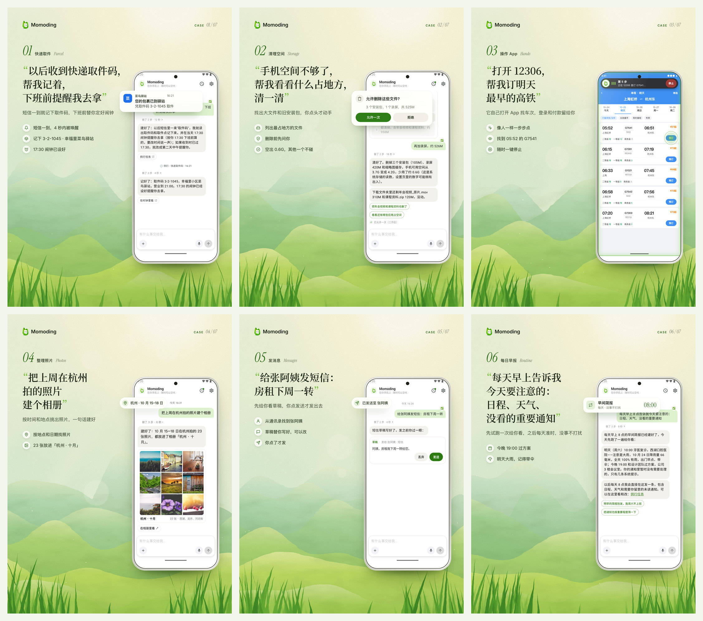

<p align="center">
  
</p>

<h1 align="center">Momoding</h1>

<p align="center"><strong>说一句，做个自己的小 App。</strong><br/>
一个住在安卓手机里的个人 Agent，能替你办事，也能把你的想法做成自己的小 App。<br/>
放到桌面，打开来用；每个 App 都有自己的 Bot，用着想改，再说一句。</p>

<p align="center">
  <a href="https://github.com/1zhangyy1/momoding/releases/latest"><strong>下载 APK</strong></a>
  · <a href="#三分钟上手">三分钟上手</a>
  · <a href="README.en.md">English</a>
</p>

<p align="center">
  <a href="https://github.com/1zhangyy1/momoding/releases"></a>
  <a href="LICENSE"></a>
  
  <a href="https://github.com/1zhangyy1/momoding/stargazers"></a>
</p>

<p align="center">
  
</p>

<p align="center"><sub>截图来自模拟器实测（模型 DeepSeek V4.1 Flash），12306 与相册两张为示意。</sub></p>

> **当前版本 1.0.10，仍在快速迭代。** 已支持一句话创建小 App、多 Bot 协作，交出去的活会变成一件件可追踪的任务；目前主要在模拟器和少数真机上打磨，国产系统的后台保活还在测。遇到问题请[提 Issue](https://github.com/1zhangyy1/momoding/issues/new/choose)。

---

## 最近更新 1.0.10：交出去的活，一件一行

- **一件事一行**：一次交代几件事，对话里就有几行，各自显示在做、做完或已停止；全部做完，你那条消息才变成 ✅。
- **边做边聊**：帮手干活时问别的事，主对话马上回答，不用等它。
- **补充或叫停**：说「只要海南和福建的」，会转给正在做的帮手；说「不用查了」，那件事就停下。
- **先别动**：说「先别发，等我确认」，这件事上的对外操作会先停住，等你点头再继续。
- **关掉 App 也不丢**：做到一半 App 被关掉或手机重启，回来接着做完；发短信这类对外操作，没确定发没发出去时会先问你，不会重复发送。
- **修复**：用 Anthropic API Key 连 Claude 失败；OpenRouter 首次启动可能选到已下线的模型；对话有新消息后仍发出旧的短信草稿；帮手用 wget 读网页还要等批准；定时任务交出去的活重启后丢失。
- **变化**：设置里的「子 Agent」页面去掉了，帮手直接用当前对话的模型。

[完整更新记录](docs/releases/1.0.10.md) · [下载 1.0.10](https://github.com/1zhangyy1/momoding/releases/tag/v1.0.10)

### 1.0.8：小 App 与多 Bot

- **一句话创建小 App**：每个 App 有自己的 Bot，做好后带着可打开的卡片回来；用着想改，在主对话里说，或点 App 里的铅笔继续改。
- **多个 Bot 分别办事**：可以一起交代几件事，各自处理、各自回报；点顶部名字切换和管理 Bot，每个 Bot 也可以有自己的 App。
- **放到手机桌面**：确认后添加快捷入口，点图标就能打开；小组件取决于手机和桌面的支持情况。
- **用上手机能力**：小 App 可在授权后选照片、拍照、定位、读取短信或通知；权限可在设置中收回。
- **检查 App 不抢当前页面**：Bot 在后台舞台打开、查看和操作自己的 App；需要你选择文件或授权时再让你接手。
- **修复与兼容**：补上部分 Bot 完成后丢失的回报；审批通知跟随 App 语言。ColorOS 暂不支持小组件，部分手机切到后台会暂停，回来后继续。

[完整更新记录](docs/releases/1.0.8.md) · [下载 1.0.8](https://github.com/1zhangyy1/momoding/releases/tag/v1.0.8)

## 从想法到桌面上的小 App

**交代一个想法 → Bot 做出来 → 放到桌面用 → 再说一句继续改。**

你可以从这样的想法开始：「做个能转着看的 3D 地标画廊」「做个用自己照片设计海报的工具」，或者一个适合自己习惯的记账本。Momoding 把需求交给专门的 Bot；做好后，Bot 在原来的对话里带着 App 卡片回来。

小 App 在 Momoding 内运行，可以添加手机桌面快捷入口。下次点图标就能用，不需要再找上次的生成结果；它不是独立安装的 APK。

**小 App 与多 Bot 演示 · 32 秒，有声**

https://github.com/user-attachments/assets/23a38fc7-352b-4260-b561-b34490856553

<p align="center"></p>

## 每个 App 都有自己的 Bot

App 是你日常使用的界面，Bot 负责理解需求、维护和修改。App 的数据、Bot 的对话和项目记忆会保留，下次接着用、接着改。

- **在 App 里直接改**：点右下角的铅笔，跟负责它的 Bot 说「换成夜晚，灯光暖一点」，或者「标题大一点，再留白一些」。也可以在主对话里交代。
- **几件事一起交代**：主 Momoding 将工作交给对应的 Bot；它们各自处理、各自回来交代结果。你也可以直接切到某个 Bot 的对话。
- **接上手机能力**：小 App 可以在你授权后使用照片、相机、位置等能力，按用途接入短信或通知。
- **检查时不抢页面**：Bot 在后台舞台检查自己的 App；需要你选择文件或授权时，再让你接手。

<p align="center"><sub>配图来自安卓模拟器。小 App 是模型生成的案例，效果取决于模型和任务；不代表每次都能一次完成。支持的手机还可添加小组件，OPPO / 一加 ColorOS 目前不支持 Momoding 小组件。</sub></p>

## 一次要办的事，也可以直接交代

建日程、设提醒、查资料、记住偏好、安排例行任务，都可以从同一个主对话开始。

我们想让一个能干活的个人 Agent 住进你现在的手机：一次要办的事，交给 Momoding；经常要用的工具，做成自己的 App。先做一件有用的小事，用起来，再慢慢改成适合自己的样子。

## 为什么好用

我们最在意的不是功能多，而是**交代一件事的感觉要轻**：

- **从一个主对话开始**：事情先交给 Momoding；需要时，点顶部名字就能切到某个 Bot，或直接在小 App 里跟它说。
- **先说结果**：办完用一句话告诉你结果，附一个能点的按钮（"在日历里看"）。过程收在"做了 N 步"里，想看再点开。
- **最多问一个问题**：信息不全时只问最关键的那一个，并给你选项，不乱猜，也不连环追问。
- **做之前先问你**：删除、发送、付款前出一张审批卡；点过"始终允许"，下次就直接做，并在对话里留一行记录。
- **不打扰**：例行任务没有要紧事就不推通知。
- **手感顺**：你发出消息，它马上回一个 👀，办完换成 ✅；回复一个气泡一个气泡地弹出来，卡片该浮起就浮起，处理完收成一行。
- **选一家就能用**：第一次只要选模型服务、填一个 Key，对话模型和看图模型自动配好。

## 设计上向谁学

**OpenMinis 是代码底座**，提供手机上的 Agent、Linux 环境和设备能力。我们在这个基础上，把自己的需要做成小 App，并让负责它的 Bot 持续维护。

- **[Fibona](https://github.com/FibonaAI/fibona-agent)**：借鉴在手机里做出工具、当场修改、留下继续用的形态。
- **Grok Bot**：借鉴多个 Bot 各自负责一件事、各有自己的对话和记忆；在 Momoding 里，每个 Bot 也可以有自己的小 App。
- **Instinct 与 Grok Bot**：借鉴对话里的结果、交接和确认卡片，让办事过程更轻。
- **[DeepSeek Harness（DSH）](https://github.com/deepseek-ai/deepseek-harness)**：后续任务执行与恢复框架的研究参考，相关改进仍在推进。

这里的「持续升级」指 Bot 修改它负责的小 App。Momoding 本体通过检查、下载正式版本来更新。

## 现在能做什么

<p align="center"></p>

**对话里交代一句就办：**

- **提醒、日程、闹钟**："明天下午 3 点提醒我给王总回电话" → 建好，附"在日历里看"。
- **记住偏好**："以后开会尽量放下午" → 一行小字"记住了"，以后排日程自动照办。
- **缺信息只问一个问题**："帮我订个闹钟" → "几点响？"，不乱猜。
- **替你写、你点了才发**："发短信给张阿姨：房租下周一转" → 草稿卡，可以改，点"发送"才真的发出去。
- **上网查**："帮我查明天上海到杭州最早的高铁" → 结果和下一步按钮（"订这班""加到日历"）。
- **例行任务**："每天早上 8 点告诉我今天要注意的事" → 先试跑一次给你看，之后按时汇报，没要紧事不推通知。
- **在手机屏幕上操作其他 App**（实验性）：打开无障碍权限后，它可以替你点、滑、输入；手机上会出现一个胶囊提示它正在操作，随时能停。

**你始终说了算：**

- **先问你**：删除、对外发送、付款这类事，执行前出一张审批卡；选"始终允许"会变成一条规则，在 设置 → 先问你 → 允许规则 里随时能删。
- **看过程**：每条回复上方的"做了 N 步"点开就是它做了什么。
- **权限就地申请**：需要日历、位置、无障碍时，在对话里出一张卡片说明用途，打开后自动接着做。

## 隐私：说清楚"本地"是什么意思

- **没有 Momoding 账号，没有 Momoding 服务器。** 对话、记忆、小 App 数据、规则和例行任务都存在你的手机上。
- **模型 Key 加密存在手机上**，只用来调用你自己选的模型服务。
- **但它不是离线的**：要让模型理解你的请求，对话内容和它办事时读到的内容（比如一条日程、一个网页）会发给**你选的那家模型服务**。选哪家、发给谁，由你决定。
- **上网查东西时**，搜索词会发给免费的搜索服务 Exa；打开网页时，手机直接访问那个网站。
- **没有统计、广告或第三方追踪 SDK。**

## 三分钟上手

1. 手机需要 **Android 8.0 或更高版本**。到 [Releases](https://github.com/1zhangyy1/momoding/releases/latest) 下载最新的 `.apk`，允许浏览器安装应用。
2. 打开 Momoding，选一家模型服务，填入你的 API Key。首次使用预设了：
   **DeepSeek**（好用不贵）、**Kimi**、**通义千问**、**智谱 GLM**、**豆包**、**硅基流动**；也支持 OpenRouter、OpenAI、Claude、Gemini 等。
   选一家就会自动配好对话模型和看图模型。
3. 在对话框里交代第一件事，或者点空白页上的例子试试。
4. 想让它替你操作其他 App：设置 → 手机权限 → **动手操作屏幕**，按提示打开无障碍和悬浮窗。不开也能用其他功能。

> **更新至 1.0.10**：已安装正式版 1.0.1～1.0.9 可直接覆盖安装，数据保留。0.1.0-alpha 或使用不同签名的早期测试包不能直接覆盖；迁移前请先备份需要保留的数据，再处理旧包。

## 常见问题

<details>
<summary><b>要花钱吗？</b></summary>

App 免费、开源。模型调用由你选的服务商按用量收费，费用直接付给服务商，Momoding 不经手。DeepSeek 这类服务日常用下来花费不多。
</details>

<details>
<summary><b>为什么不上应用商店？</b></summary>

它要用无障碍、悬浮窗、后台常驻这些能力替你办事，应用商店对这类 App 审核很严。现阶段先在 GitHub 发布，所有代码都可以审查。
</details>

<details>
<summary><b>它会不会乱操作我的手机？</b></summary>

不开无障碍权限，它就碰不到其他 App。开了以后，删除、发送、付款这类事都会先问你；操作时屏幕上有胶囊提示，随时能停；每一步都能在"看过程"里查到。
</details>

<details>
<summary><b>有 iOS 版吗？</b></summary>

目前只做 Android。仓库里的 `src/ios/` 是上游 OpenMinis 的 iOS 代码，Momoding 没有维护。
</details>

## 从源码构建

Momoding 带一个运行在手机上的 Linux 沙箱，原生依赖（PRoot、FFmpeg、LAME、rclone）和 Alpine rootfs 都要从源码构建：

```sh
git clone --recurse-submodules https://github.com/1zhangyy1/momoding.git
cd momoding

# 需要 Android NDK r28+、Go 1.25+ 和 gomobile
./deps/build_proot.sh && ./scripts/prepare_android_sandbox.sh
./deps/build_rclone_android.sh
mkdir -p src/android/app/libs && cp deps/build/rclone/rclone.aar src/android/app/libs/
cd src/android && ./gradlew :app:assembleDebug
```

工具链要求和常见构建错误见 [BUILDING.md](BUILDING.md)。

**代码在哪：** Momoding 自己的界面和逻辑在 `src/android/app/src/main/java/app/momoding/`（对话里的卡片、首次使用、权限、例行任务、提示词等）；其余基本保持上游原样，方便持续合并 OpenMinis 的更新。

## 参与进来

- **反馈问题、提需求**：[GitHub Issues](https://github.com/1zhangyy1/momoding/issues/new/choose)。说清楚你想让它办什么、它实际做了什么，比什么都有用。
- **聊想法、分享用法**：[Discussions](https://github.com/1zhangyy1/momoding/discussions)
- **提交代码**：欢迎 PR，先看 [CONTRIBUTING.md](CONTRIBUTING.md)。

如果 Momoding 帮你少搬、少记、少盯了一点，给个 ⭐ 是对我们最大的鼓励。

## 许可证

[GNU General Public License v3.0](LICENSE)。Momoding 基于 GPLv3 的 OpenMinis，并链接了 GPL 组件（PRoot 为 GPLv2），因此整体以 GPLv3 发布。

## 致谢

Momoding 是 [OpenMinis](https://github.com/OpenMinis/OpenMinis) 的一个 fork，能做出来首先要感谢 OpenMinis 团队。他们把一个打磨得非常好的手机端 Agent 完整开源了：智能体循环、跑在手机上的 Linux 沙箱、设备能力、浏览器自动化、技能、记忆、众多模型服务的接入，这些都是 Momoding 的地基。我们在此之上做的是产品形态：单一的办事员对话、中文优先的说话方式、对话里的各种卡片、例行任务和整套视觉设计。如果你喜欢 Momoding，也请去给 OpenMinis 点个 ⭐，iPhone 上推荐直接用 [Minis](https://apps.apple.com/app/id6759188481)。同样感谢 [nanoMuse](https://github.com/nano-muse/nanoMuse)（不少模块从它移植而来）、[Mobilerun（droidrun）](https://github.com/droidrun/droidrun) 和 [RikkaHub](https://github.com/rikkahub/rikkahub)（屏幕操作的思路），以及 Instinct 和 Grok Bot（产品设计参考）；还有 iSH、PRoot、Alpine Linux、FFmpeg 等开源项目，完整清单见 [THIRD_PARTY_LICENSES.md](THIRD_PARTY_LICENSES.md)。Momoding 和以上项目都没有隶属关系。
